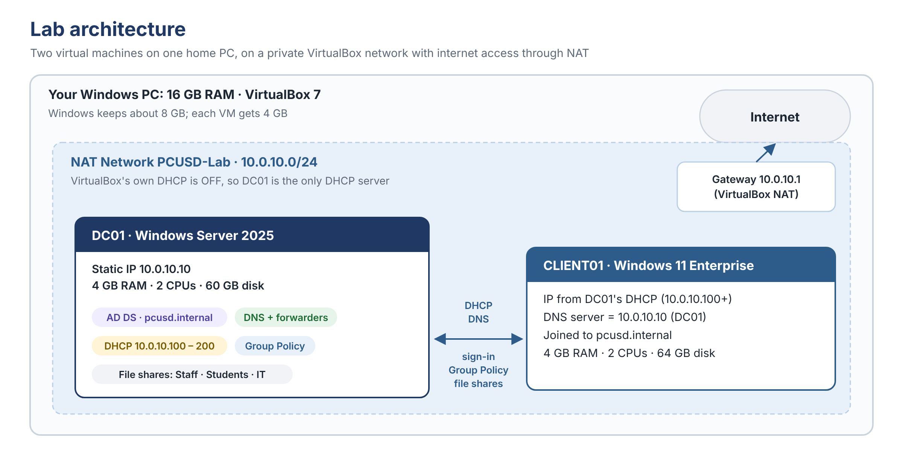
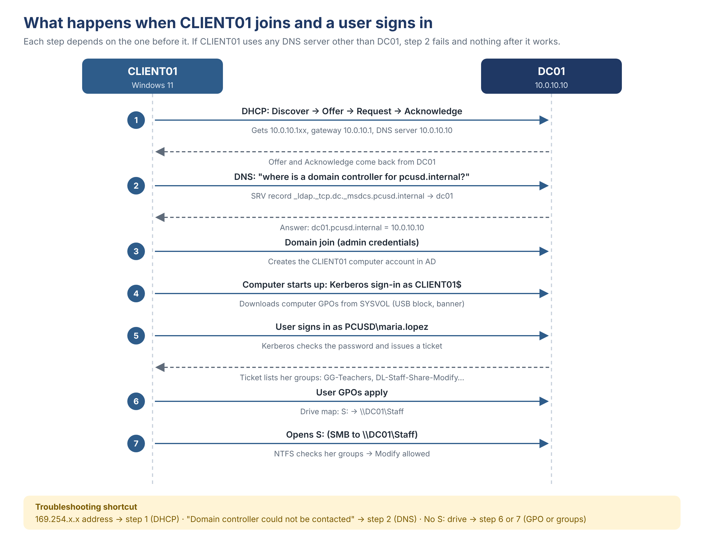
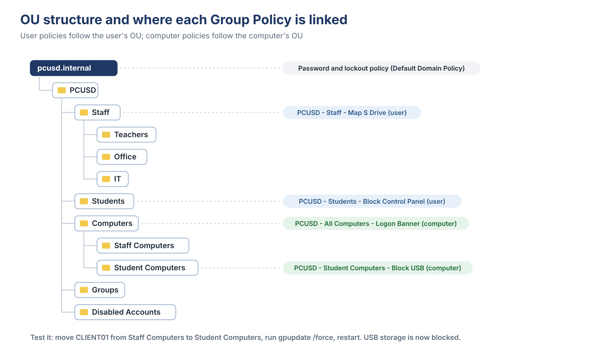
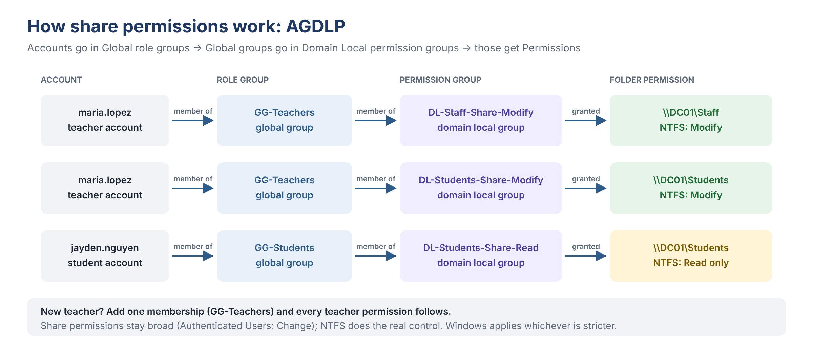

# Active Directory Home Lab

A small school district network built in VirtualBox on my home PC: a Windows Server domain controller running Active Directory, DNS and DHCP, plus a Windows 11 PC joined to the domain. I use it to practice the work a help desk and junior sysadmin do every day: creating accounts, resetting passwords, setting Group Policy, and fixing access problems.

The lab models **Pacific Crest Unified School District** (fictional), the same district used in my other projects: the [PowerShell toolkit](../05_PowerShell-Admin-Toolkit), [help desk tickets](../06_Help-Desk-Ticket-Portfolio), [school network design](../07_School-Network-Packet-Tracer) and [Chromebook tracker](../08_Chromebook-Device-Tracker).

## What's in the lab

| Piece | Details |
|---|---|
| Host | Windows PC, 16 GB RAM, VirtualBox |
| DC01 | Windows Server 2025 (180-day evaluation), 4 GB RAM. Roles: AD DS, DNS, DHCP, file server |
| CLIENT01 | Windows 11 Enterprise (90-day evaluation), 4 GB RAM, joined to the domain |
| Network | VirtualBox NAT Network `PCUSD-Lab`, 10.0.10.0/24, internet access through NAT |
| Domain | `pcusd.internal` (NetBIOS name `PCUSD`) |

## What I configured

- **Domain controller:** static IP, AD DS forest `pcusd.internal`, DNS with internet forwarders, DHCP scope that hands out the DC as the DNS server
- **Organizational units:** Staff (Teachers, Office, IT), Students, Computers (Staff, Student), Groups, Disabled Accounts
- **Users and groups:** 20 staff and students created from a CSV with my [PowerShell toolkit](../05_PowerShell-Admin-Toolkit); role-based security groups
- **Group Policy:** password and lockout policy, mapped S: drive for staff, Control Panel blocked for students, USB storage blocked on student computers, logon banner
- **File shares:** Staff, Students and IT shares with share and NTFS permissions set through groups (AGDLP)
- **Help desk practice:** password resets, account unlocks, "can't open the shared drive", new hire and leaver processes (see [docs/08-help-desk-practice.md](docs/08-help-desk-practice.md))

## How it works

[**0. How it works (deep dive)**](docs/00-how-it-works.md) explains the why behind every step: how clients find the domain through DNS, what happens during sign-in, how Group Policy decides what applies, and how share permissions are worked out.

| Sign-in, step by step | Where each policy applies | How permissions flow |
|---|---|---|
|  |  |  |

## Build guide

Follow these in order. Each step ends with screenshots to take for the [screenshots](screenshots) folder, and a "What you should see" check so you know it worked before moving on.

0. [How it works (deep dive)](docs/00-how-it-works.md)
1. [Plan and downloads](docs/01-plan-and-downloads.md)
2. [Create the virtual machines](docs/02-create-virtual-machines.md)
3. [Build the domain controller (AD DS, DNS, DHCP)](docs/03-build-domain-controller.md)
4. [OUs, users and groups](docs/04-ous-users-groups.md)
5. [Join a Windows 11 PC to the domain](docs/05-join-windows-11-pc.md)
6. [Group Policy](docs/06-group-policy.md)
7. [File shares and permissions](docs/07-file-shares-and-permissions.md)
8. [Help desk practice](docs/08-help-desk-practice.md)
9. [Explaining the lab in an interview](docs/09-interview-prep.md)
10. [Build log](docs/10-build-log.md)

Setup scripts are in [scripts](scripts). Each one is short and commented, and every step also has GUI instructions so I know what the script is doing.

## Checking the lab

[`scripts/7-Test-LabHealth.ps1`](scripts/7-Test-LabHealth.ps1) runs 36 checks on DC01 (services, DNS records, the DHCP scope, OUs, group nesting, users, GPO links, share permissions and the client) and prints PASS, WARN or FAIL for each, with the step that fixes anything missing. It also saves an HTML report. I run it after every step to track progress.

## Screenshots

See [screenshots/README.md](screenshots/README.md) for the checklist and how each one is taken. Screenshots are added as I complete each step; every one comes from my own lab.

## What I learned

_Write 3–5 bullets here after building the lab, from the "Problems I hit" table in the [build log](docs/10-build-log.md): what broke, how you found the cause, and how you fixed it. Interviewers ask about this._

## Interview talking points

More questions, troubleshooting scenarios and a 60-second summary are in [docs/09-interview-prep.md](docs/09-interview-prep.md).

- **Why DNS matters for AD:** clients find domain controllers through DNS SRV records, so domain PCs must use the DC for DNS. Most "can't join the domain" problems are DNS problems.
- **OUs vs groups:** OUs organize objects so Group Policy and delegation can target them; groups grant access to resources. A user is in one OU but can be in many groups.
- **AGDLP:** permissions go to domain local groups, people go in global role groups, and role groups nest into permission groups. Access changes become one membership change.
- **Least privilege:** the help desk group can reset passwords in the Staff and Students OUs through delegation, without being Domain Admins. I use a separate admin account for admin work.
- **Disable, don't delete:** leavers are disabled and moved to their own OU so their files and history stay available.

## Skills shown

Windows Server, Active Directory Users and Computers, DNS, DHCP, Group Policy Management, NTFS and share permissions, PowerShell, VirtualBox networking, troubleshooting domain joins and logons.
