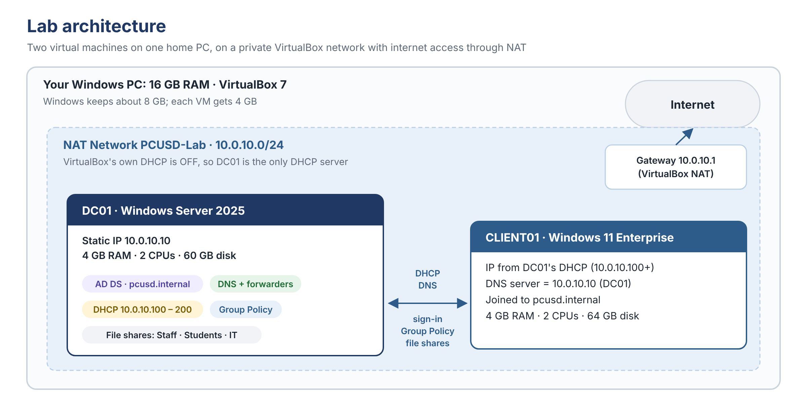
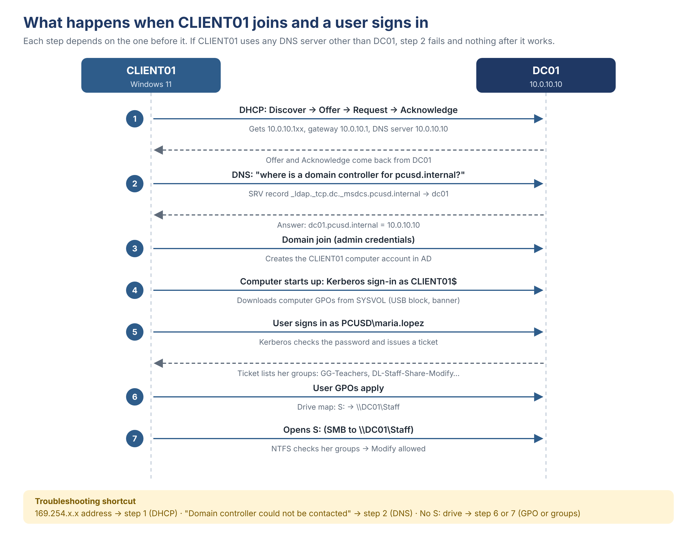
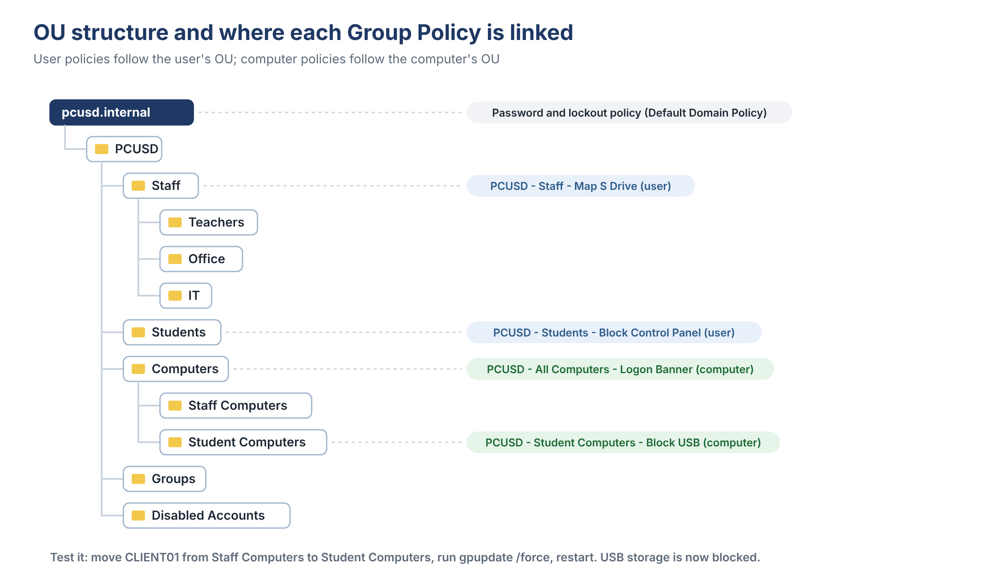
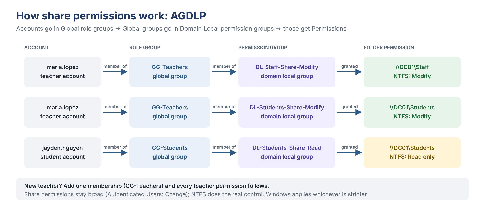

# 0. How it works (deep dive)

Read this before you build, then again after. The build steps tell you *what* to click; this page explains *why* it works, so you can troubleshoot it and explain it in an interview.

Contents:
1. [The big picture](#1-the-big-picture)
2. [Active Directory: what it actually is](#2-active-directory-what-it-actually-is)
3. [DNS: how computers find the domain](#3-dns-how-computers-find-the-domain)
4. [DHCP: how CLIENT01 gets on the network](#4-dhcp-how-client01-gets-on-the-network)
5. [Joining the domain and signing in](#5-joining-the-domain-and-signing-in)
6. [OUs, containers and groups](#6-ous-containers-and-groups)
7. [Group Policy](#7-group-policy)
8. [File share permissions](#8-file-share-permissions)
9. [Checking the whole lab](#9-checking-the-whole-lab)
10. [Glossary](#10-glossary)

---

## 1. The big picture



Everything runs on one PC. VirtualBox creates a private network, `PCUSD-Lab` (10.0.10.0/24), that the two VMs share. VirtualBox's built-in router at 10.0.10.1 gives that network internet access through NAT, the same way a home router does. Your home network can't see the VMs, so nothing in the lab can interfere with your real devices.

DC01 does four jobs that a real district would spread over several servers:

| Role | What it does for the lab | In a real district |
|---|---|---|
| AD DS | Stores every user, computer and group; checks passwords | 2+ domain controllers per site for redundancy |
| DNS | Tells computers where the domain controller is | Runs on the domain controllers |
| DHCP | Hands CLIENT01 an IP address and tells it which DNS server to use | Often on a separate server or on the network core switch |
| File server | Hosts `\\DC01\Staff`, `Students` and `IT` | Separate file server or SharePoint/OneDrive |

Putting everything on one DC is fine for a lab. Say so in an interview; it shows you know the real-world design.

---

## 2. Active Directory: what it actually is

Active Directory Domain Services (AD DS) is a database plus the services that use it. The database file is `C:\Windows\NTDS\ntds.dit` on every domain controller.

- **Domain** (`pcusd.internal`): the security boundary. Every account in it shares one password policy and trusts the same domain controllers.
- **Forest**: one or more domains that trust each other. This lab has one forest with one domain, which is what most school districts have.
- **Domain controller (DC)**: a server that holds a copy of the database and answers sign-in requests. With two DCs, either can answer, and changes replicate between them.
- **Objects**: users, computers, groups, OUs, GPO links. Every object has a *distinguished name* (DN) that spells out where it lives, read right to left:

```
CN=Maria Lopez,OU=Teachers,OU=Staff,OU=PCUSD,DC=pcusd,DC=internal
   the user     in Teachers  in Staff  in PCUSD  in pcusd.internal
```

- **SYSVOL**: a shared folder on every DC (`\\pcusd.internal\SYSVOL`) holding Group Policy files and logon scripts. DFS Replication copies it between DCs.

**Why `pcusd.internal` and not `pcusd.local`?** `.local` clashes with multicast DNS (used by Apple devices and printers), which causes odd name lookup problems. In 2024 ICANN reserved `.internal` for private networks, so it will never be a real internet domain. Many older districts still use `.local`; in an interview you can say you know why newer guidance avoids it.

**Single DC = single point of failure.** If DC01 is off, nobody can sign in with a new session, and DHCP and DNS stop too. Real districts run at least two DCs. Mentioning this shows you understand the trade-off you made for the lab.

---

## 3. DNS: how computers find the domain

This is the most important section. **Most "can't join the domain" and "slow sign-in" problems are DNS problems.**

When DC01 became a domain controller, it registered **SRV records** in DNS. An SRV record says "the service X for domain Y is on server Z". CLIENT01 looks for:

```
_ldap._tcp.dc._msdcs.pcusd.internal   → dc01.pcusd.internal, port 389   (directory)
_kerberos._tcp.pcusd.internal         → dc01.pcusd.internal, port 88    (sign-in)
```

Then a normal A record turns the name into an address: `dc01.pcusd.internal → 10.0.10.10`.

Public DNS servers like 8.8.8.8 have never heard of `pcusd.internal`. So **every domain computer must use the DC for DNS**, and the DC passes internet lookups (google.com) on to public DNS through **forwarders**.

```
CLIENT01 asks DC01: "where is dc01.pcusd.internal?"  → DC01 answers itself (it owns the zone)
CLIENT01 asks DC01: "where is www.google.com?"       → DC01 forwards to 1.1.1.1 / 8.8.8.8, passes the answer back
```

**Zones in this lab:**

| Zone | Type | Holds |
|---|---|---|
| `pcusd.internal` | Forward lookup, AD-integrated | Name → IP (A records) and the SRV records |
| `_msdcs.pcusd.internal` | Forward lookup, AD-integrated | DC-locator records for the forest |
| `10.0.10.in-addr.arpa` | Reverse lookup | IP → name (PTR records), so `nslookup 10.0.10.10` shows `dc01` |

"AD-integrated" means the zone is stored in Active Directory, so it replicates to every DC automatically.

**Try it yourself (on CLIENT01):**

```
nslookup -type=SRV _ldap._tcp.dc._msdcs.pcusd.internal
nltest /dsgetdc:pcusd.internal
```

`nltest` asks Windows to find a DC exactly the way sign-in does. If it fails, the domain join will fail too.

---

## 4. DHCP: how CLIENT01 gets on the network

DHCP hands out addresses in four messages, remembered as **DORA**:

| Step | From → To | Message |
|---|---|---|
| **D**iscover | CLIENT01 → everyone (broadcast) | "I need an address" |
| **O**ffer | DC01 → CLIENT01 | "You can have 10.0.10.100" |
| **R**equest | CLIENT01 → everyone (broadcast) | "I'll take 10.0.10.100" |
| **A**cknowledge | DC01 → CLIENT01 | "It's yours for 1 day" (the lease length script 3 sets) |

The offer also carries **scope options**, and these matter as much as the address:

| Option | Name | Value in this lab | Why it matters |
|---|---|---|---|
| 003 | Router | 10.0.10.1 | Way out to the internet |
| 006 | DNS Servers | 10.0.10.10 | **Must be the DC**, or the domain can't be found |
| 015 | DNS Domain Name | pcusd.internal | Lets users type `dc01` instead of the full name |

**Why VirtualBox's DHCP is turned off:** if two DHCP servers answer on one network, whichever replies first wins. VirtualBox's would hand out its own DNS server instead of 10.0.10.10, and CLIENT01 would randomly fail to find the domain. Same thing happens in real schools when someone plugs in a home router; it's called a **rogue DHCP server**.

**Why DHCP is "authorized" in AD:** a Windows DHCP server checks AD before it hands out addresses. An unauthorized one stays quiet. This stops a stray Windows server from becoming a rogue DHCP server.

**Address you see on CLIENT01 → what it means:**

| Address | Meaning |
|---|---|
| 10.0.10.100–200 | DHCP worked |
| 169.254.x.x | No DHCP server answered (APIPA). Check the scope is active and authorized, and that the VM is on `PCUSD-Lab` |
| 10.0.2.x | VM is on plain "NAT", not the "NAT Network". Fix the adapter setting |

---

## 5. Joining the domain and signing in



**Joining (step 3 in the diagram)** creates a computer account, `CLIENT01$`, in AD with its own password that the PC and DC agree on. That shared secret is the **secure channel**. It's why the computer "belongs" to the domain. If you restore an old VM snapshot, the PC has an old computer password that no longer matches, and you get *"The trust relationship between this workstation and the primary domain failed."* Fix: `Test-ComputerSecureChannel -Repair`, or leave and rejoin the domain.

**Kerberos** is how sign-in works without sending the password over the network:

1. You type your password. CLIENT01 uses it to prove who you are to the **Key Distribution Center (KDC)** on DC01.
2. The KDC gives back a **ticket-granting ticket (TGT)**, a pass that's good for about 10 hours.
3. When you open `\\DC01\Staff`, CLIENT01 shows the TGT and gets a **service ticket** for that server.
4. The ticket includes a list of your groups. The file server uses that list to check permissions.

Two things follow from this, and both come up in help desk work:

- **Group changes need a fresh sign-in.** Your group list was written into your ticket when you signed in. If you add someone to `GG-Teachers`, they have to sign out and back in (or run `klist purge`) before the new access works.
- **Clocks must agree within 5 minutes.** Kerberos tickets are time-stamped. If a VM's clock drifts (common after a host sleeps), sign-in fails with time-related errors. Domain PCs sync time from the DC automatically.

See your own tickets on CLIENT01 with `klist`.

---

## 6. OUs, containers and groups



These three get mixed up a lot, and interviewers like asking about them.

| | What it's for | Can link a GPO? | Can give access to a folder? |
|---|---|---|---|
| **OU** (organizational unit) | Organizing objects so policy and admin rights can target them | Yes | No |
| **Container** (e.g. the default `Computers` and `Users`) | Default holding area made by Windows | **No** | No |
| **Group** | Granting access and rights | No (only for filtering) | Yes |

An object lives in **exactly one OU**, but can be in **many groups**.

**Why CLIENT01 has to be moved (step 5.3):** a newly joined PC lands in the built-in `Computers` *container*. You can't link a GPO to a container, so only domain-wide policies reach it. Moving it into `PCUSD > Computers > Staff Computers` is what makes the district policies apply. (In a real district you'd automate this with `redircmp` or by pre-creating the computer account in the right OU.)

**Group scopes** decide who can be a member and where the group can be used:

| Scope | Can contain | Use it for | In this lab |
|---|---|---|---|
| Global | Users and groups from the same domain | Roles: who people are | `GG-Teachers`, `GG-Students`, `GG-Office`, `GG-IT` |
| Domain local | Users and groups from anywhere in the forest | Permissions: what they can access | `DL-Staff-Share-Modify`, etc. |
| Universal | Anything in the forest | Multi-domain forests | Not used |

**Delegation (step 4.3)** gives `GG-IT` the right to reset passwords in the Staff and Students OUs only. The help desk doesn't need to be Domain Admins for that, which is **least privilege** in practice.

---

## 7. Group Policy

A **Group Policy Object (GPO)** is a bundle of settings. It has two halves:

- **Computer Configuration**: applies to computers in the OU it's linked to, at startup. Example: *Block USB* on `Student Computers`.
- **User Configuration**: applies to users in the OU it's linked to, at sign-in, on any computer. Example: *Block Control Panel* on `Students`.

This is the most common mistake: **linking a user policy to a computer OU (or the other way round) does nothing.** The S: drive policy is a user setting, so it's linked to `Staff` (where the users are), not `Staff Computers`.

**Processing order: LSDOU.** Policies apply in this order, and **the last one applied wins** if two settings conflict:

```
Local policy  →  Site  →  Domain  →  OU (parent first, then child)
```

So a setting on `OU=Students` beats the same setting at the domain level. Two exceptions change this: **Enforced** on a link (the parent wins anyway) and **Block Inheritance** on an OU (ignore parent GPOs that aren't enforced).

**Password policy is special.** For domain accounts it only takes effect from a GPO linked at the **domain** level (normally the Default Domain Policy). Putting a password policy on an OU doesn't change domain passwords. Script 6 uses `Set-ADDefaultDomainPasswordPolicy`, which edits the Default Domain Policy for you. (Different policies for different groups need *Fine-Grained Password Policies*, a good follow-up topic.)

**Policies vs preferences.** The S: drive is a *Group Policy Preference*. Policies (Administrative Templates) are enforced and the user can't change them. Preferences set a starting value the user could change, and are used for drive maps, printers and shortcuts.

**When policies refresh:** at startup and sign-in, then about every 90 minutes (plus a random 0–30 minutes so every PC doesn't hit the DC at once). `gpupdate /force` applies them now. Some computer settings (like USB blocking) need a restart.

**Proving what applied:** on CLIENT01,

```
gpresult /r                      # quick summary: which GPOs applied to the computer and the user
gpresult /h C:\Temp\gp.html      # full report, including "Denied GPOs" and why
```

The GPO itself is stored in two places: its settings are files in SYSVOL, and its link and version number are in AD. That's why both AD and SYSVOL replication need to be healthy for GPOs to work.

---

## 8. File share permissions



**AGDLP** keeps permissions manageable:

> **A**ccounts go into **G**lobal (role) groups → global groups go into **D**omain **L**ocal (permission) groups → domain local groups get **P**ermissions.

Without it, you'd add 40 teachers to the folder one by one, and remove each one when they leave. With it, the folder only ever lists `DL-Staff-Share-Modify`, and you manage people by role. A new teacher is one change: add them to `GG-Teachers`.

**Two layers of permissions** protect a share:

| Layer | Set on | Applies when | This lab |
|---|---|---|---|
| Share permissions | The share (Sharing tab) | Only over the network | Broad: Authenticated Users = Change |
| NTFS permissions | The folder (Security tab) | Always, locally and over the network | Narrow: only `DL-` groups, SYSTEM, Administrators |

Over the network, Windows works out both and **applies whichever is more restrictive**. Keeping share permissions broad and doing the real control in NTFS means there's only one place to look when someone can't get in.

**Inheritance** is turned off on each share folder. Otherwise the folder would inherit `C:\`'s default "Users: Read & execute", and every domain user (including students) could read the Staff share.

**Access-based enumeration (ABE)** hides folders a user can't open. A student browsing `\\DC01` sees `Students` but not `Staff` or `IT`. Less confusion, fewer tickets.

**Deny beats Allow**, but avoid Deny entries; they're hard to troubleshoot. Leaving someone out of the group is cleaner.

**Effective Access** (folder > Properties > Security > Advanced > Effective Access) shows what a user can really do after all groups are counted. It's the first thing to check on an "I can't open the shared drive" ticket.

---

## 9. Checking the whole lab

`scripts/7-Test-LabHealth.ps1` checks every part of this page in one run and tells you what to fix:

```powershell
# On DC01, as PCUSD\gavin.admin, in PowerShell as Administrator
Set-ExecutionPolicy -Scope Process -ExecutionPolicy Bypass
.\7-Test-LabHealth.ps1
```

Run it after each build step. Checks for steps you haven't done yet show **FAIL** with the step that fixes them, so it doubles as a progress tracker. It also saves an HTML report to your Desktop; a screenshot of the all-PASS report is a good final portfolio image.

What you should see when everything is built (your times and lease addresses will differ):

```
[PASS] Server    Computer name is DC01  - Name: DC01
[PASS] Server    Static IP 10.0.10.10  - 10.0.10.10 (Manual)
[PASS] Server    Windows is activated  - License status code: 1 (1 = licensed)
...
[PASS] DNS       Domain controller SRV record  - Targets: dc01.pcusd.internal
[PASS] DHCP      Scope gives out DC01 as DNS  - Option 6 (DNS): 10.0.10.10
[PASS] Structure Groups exist and are nested (AGDLP)  - 4 permission groups, nesting correct
[PASS] Users     Users created in the PCUSD OUs  - 20 users. Teachers: 6 | Office: 3 | IT: 2 | Students: 9
[PASS] Policy    GPO linked: PCUSD - Staff - Map S Drive  - Linked to OU=Staff
[PASS] Shares    \\DC01\Students shared with permission groups  - Path C:\Shares\Students; ABE AccessBased; inheritance off
[PASS] Client    CLIENT01 is in a PCUSD computers OU  - In OU=Staff Computers,OU=Computers,OU=PCUSD,DC=pcusd,DC=internal

PASS 36   WARN 0   FAIL 0
Report saved to C:\Users\gavin.admin\Desktop\lab-health-20261117-1530.html
```

A **WARN** is something worth knowing but not broken (for example, CLIENT01 is turned off so it doesn't answer ping).

---

## 10. Glossary

| Term | Plain meaning |
|---|---|
| AD DS | Active Directory Domain Services: the directory database and sign-in service |
| AGDLP | Accounts → Global groups → Domain Local groups → Permissions |
| APIPA | The 169.254.x.x address Windows gives itself when DHCP doesn't answer |
| DC | Domain controller: a server running AD DS |
| DN | Distinguished name: an object's full path in AD |
| DORA | Discover, Offer, Request, Acknowledge: the four DHCP messages |
| DSRM | Directory Services Restore Mode: a recovery mode for a DC, with its own password |
| Forwarder | Where a DNS server sends lookups it can't answer itself |
| GPO | Group Policy Object: a bundle of settings linked to a site, domain or OU |
| KDC | Key Distribution Center: the part of a DC that issues Kerberos tickets |
| LSDOU | Local, Site, Domain, OU: the order GPOs apply |
| NTFS permissions | Permissions on files and folders, set on the Security tab |
| OU | Organizational unit: a folder in AD that GPOs and delegation can target |
| RSAT | Remote Server Administration Tools: ADUC, GPMC, DNS and DHCP consoles for Windows 11 |
| Secure channel | The trust between a domain computer and the DC, based on the computer account's password |
| SRV record | DNS record that says which server provides a service (like a DC) |
| SYSVOL | Shared folder on every DC holding Group Policy files |
| TGT | Ticket-granting ticket: the Kerberos pass you get at sign-in |
