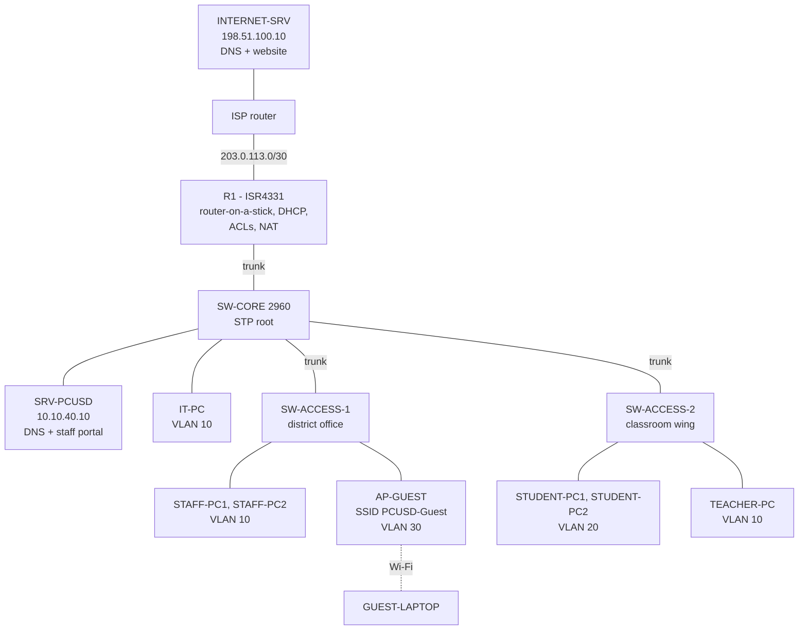

# School Network Design (Cisco Packet Tracer)

A segmented network for one campus of **Pacific Crest Unified School District** (fictional), built in Cisco Packet Tracer. Staff, students, guests, servers and network management each get their own VLAN. One router hands out addresses, controls which groups can talk to each other, and shares one public address for internet access.

## Topology

## VLANs and addressing

| VLAN | Name | Network | Gateway (R1) | Addresses |
|---|---|---|---|---|
| 10 | STAFF | 10.10.10.0/24 | 10.10.10.1 | DHCP .21–.254, DNS 10.10.40.10 |
| 20 | STUDENTS | 10.10.20.0/24 | 10.10.20.1 | DHCP .21–.254, DNS 10.10.40.10 |
| 30 | GUEST | 10.10.30.0/24 | 10.10.30.1 | DHCP .21–.254, public DNS 198.51.100.10 |
| 40 | SERVERS | 10.10.40.0/24 | 10.10.40.1 | Static: SRV-PCUSD .10 |
| 99 | MANAGEMENT | 10.10.99.0/24 | 10.10.99.1 | Static: SW-CORE .2, SW-ACCESS-1 .3, SW-ACCESS-2 .4 |
| 999 | BLACKHOLE | none | none | Unused ports, shut down |
| 1000 | NATIVE | none | none | Native VLAN on trunks (no devices) |
| n/a | ISP link | 203.0.113.0/30 | n/a | R1 .2, ISP .1 |

## Who can reach what

Enforced by two ACLs on R1, applied inbound on the student and guest subinterfaces.

| From \ To | Staff | Students | Servers | Management | Internet |
|---|---|---|---|---|---|
| **Staff** | ✅ | ✅ | ✅ | ✅ | ✅ |
| **Students** | ❌ replies only | ✅ | ✅ | ❌ | ✅ |
| **Guests** | ❌ | ❌ | ❌ | ❌ | ✅ |

"Replies only": a teacher can reach a student PC and get answers back (`established` TCP and ICMP echo-reply are allowed), but a student can't start a connection to a staff PC.

## Security choices

- **Segmentation:** a compromised student or guest device can't reach staff PCs or network gear.
- **Management VLAN** for switch access, **SSH only** with local accounts, no Telnet.
- **Port security** (max 2 MAC addresses, sticky) on desk and classroom ports, so a student can't plug in a personal switch.
- **Unused ports** shut down and parked in VLAN 999; trunks use an unused **native VLAN 1000** and don't negotiate (no DTP).
- **VTP transparent** so one switch can't wipe the others' VLANs.
- **SW-CORE is the spanning-tree root**, so traffic takes predictable paths.

## Files

| File | What it is |
|---|---|
| [configs](configs) | Full CLI configs for R1, ISP, SW-CORE, SW-ACCESS-1, SW-ACCESS-2 |
| [docs/build-guide.md](docs/build-guide.md) | Step-by-step build in Packet Tracer |
| [docs/test-plan.md](docs/test-plan.md) | 20 tests with expected and actual results |
| `pcusd-school-network.pkt` | The Packet Tracer file (added after building) |
| [screenshots](screenshots) | Topology and `show` command output |

## Interview talking points

- **Why VLANs?** They separate groups on the same switches, shrink broadcast domains, and give the router a place to apply rules between groups.
- **Router-on-a-stick:** one router port carries all VLANs as tagged subinterfaces. Fine for a small campus; a larger site would route on a Layer 3 switch.
- **Why `established` in the student ACL?** Blocking students from staff with a plain deny would also block the replies to staff-started connections. Allowing only established TCP and echo-replies keeps it one-way.
- **NAT overload (PAT):** every district device shares one public address; the router tracks connections by port.
- **Guest DHCP pool exhaustion** (help desk ticket HD-1009): a /24 has about 230 usable leases here; a big event can use them up. The fix is a shorter lease (`lease 0 4` = 4 hours) or a bigger subnet.

## Skills shown

VLANs, 802.1Q trunking, inter-VLAN routing, DHCP, extended ACLs, NAT/PAT, port security, SSH, spanning tree, network documentation and testing.
