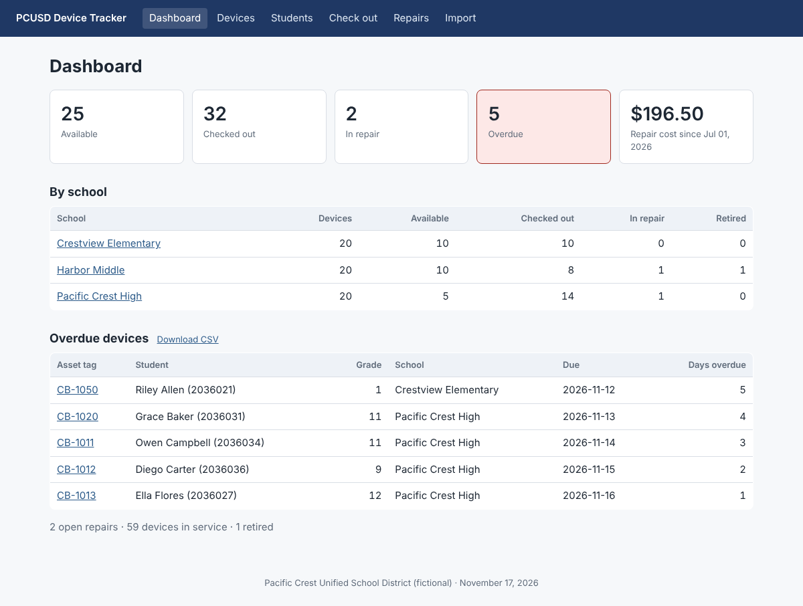
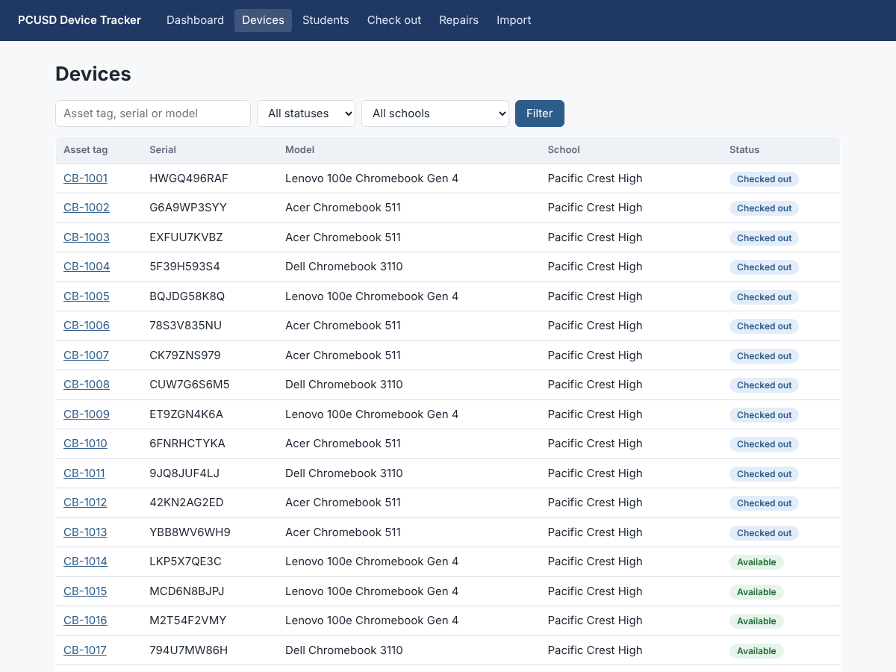
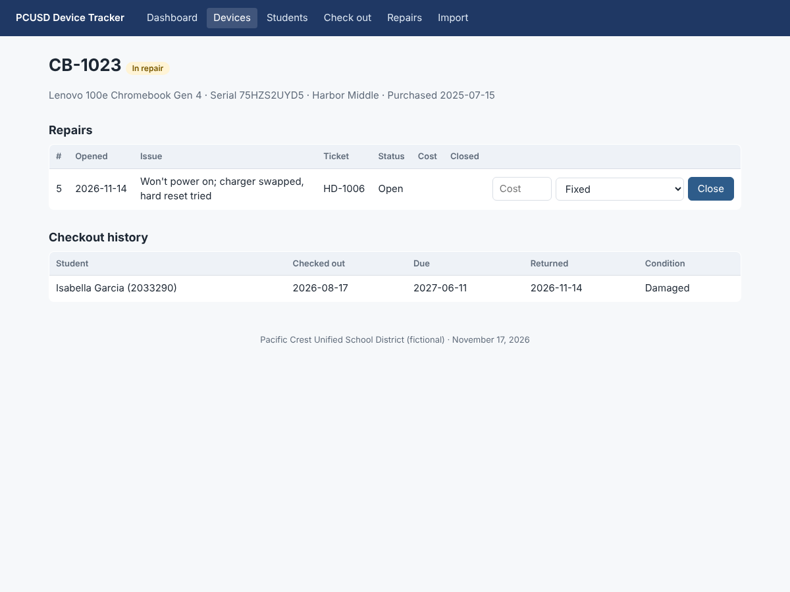
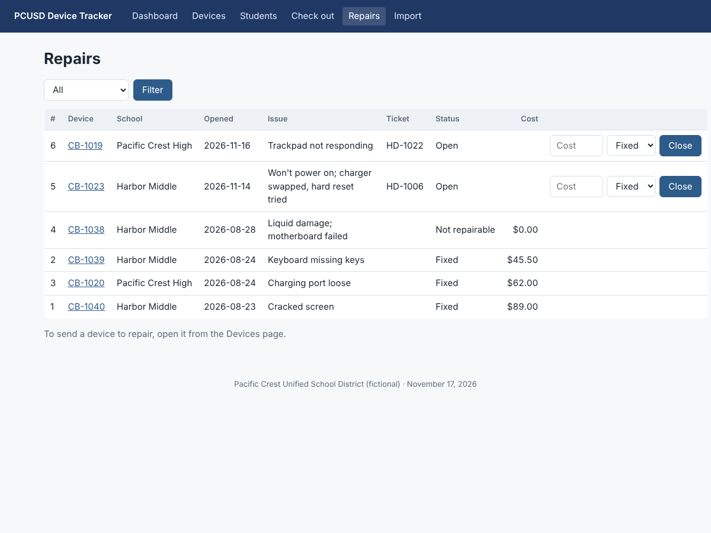
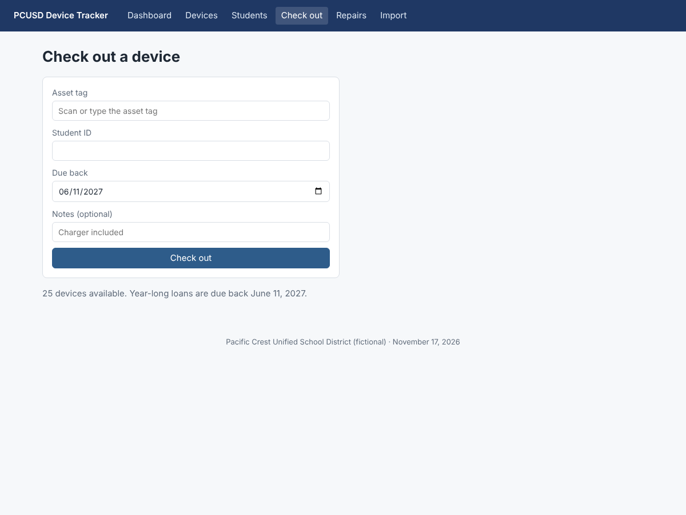

# Chromebook Device Tracker (Python, Flask, SQLite)

A web app for a school district's student device program. IT staff check Chromebooks out to students, check them back in, send damaged ones to repair, and see what's overdue, all in one place. Built for **Pacific Crest Unified School District** (fictional), the district from my other projects. Help desk ticket [HD-1006](../06_Help-Desk-Ticket-Portfolio/tickets/tickets.csv) (a Chromebook that won't power on) is in the sample data.



## Features

- **Dashboard:** devices available, checked out and in repair; overdue loans; repair spending this school year; totals by school
- **Check out / check in:** asset tag and student ID (works with a barcode scanner, which types like a keyboard). Year-long loans default to the second Friday of June.
- **Damage on return:** describing damage at check-in opens a repair automatically and takes the device out of circulation
- **Repairs:** open, close as fixed (back in service) or not repairable (retired), with cost and help desk ticket number
- **Device history:** every student who had a device and every repair
- **CSV import** for devices and students: good rows are added; duplicates and bad rows are skipped with the line number and reason
- **Overdue report** as a CSV download for school offices

## Rules it enforces

| Rule | Where |
|---|---|
| A device can only be out with one student, and a student can only have one device | Code checks **and** unique indexes in the database |
| Only Available devices can be checked out; checked-out devices must be checked in before repair | Code |
| Due dates can't be in the past; repair costs can't be negative | Code and database `CHECK` constraints |
| Grades are K–12; student IDs are digits; asset tags are stored in uppercase | Code |
| Each multi-step change (check-in + repair + status) happens in one database transaction | Code |

## Run it

Requires Python 3.9+.

```bash
cd 08_Chromebook-Device-Tracker
pip install -r requirements.txt
python seed.py          # sample data: 3 schools, 60 Chromebooks, 45 students
python app.py
```

Open http://127.0.0.1:5000. Try importing `sample_data/devices.csv` and `sample_data/students.csv` on the Import page; each has 3 good rows and 3 bad ones to show the error report.

## Tests

```bash
python -m unittest discover tests -v
```

32 tests: checkout and check-in rules, repairs, overdue math, the school-year due date, CSV import (including Excel's byte-order mark), and every page through Flask's test client.

## Screenshots

| Page | |
|---|---|
| Devices list with filters |  |
| Device detail: in repair after ticket HD-1006 |  |
| Repairs |  |
| Check out |  |

## How it's built

| File | What it does |
|---|---|
| `tracker.py` | Business rules and database access on plain `sqlite3`, so they can be tested without the web app |
| `app.py` | Flask routes; each one calls `tracker.py` and shows rule errors as messages instead of crashing |
| `schema.sql` | Tables, `CHECK` constraints and unique indexes |
| `templates/`, `static/` | Jinja pages and CSS (no JavaScript needed) |
| `seed.py` | Sample data with dates based on today |

All SQL uses parameters (no string-built queries), and Jinja escapes everything shown on a page.

## What a real district version would add

Sign-in with district accounts and roles (help desk vs. read-only office staff), CSRF protection on forms, a production web server instead of Flask's built-in one, and a sync with the student information system instead of CSV imports.

## Interview talking points

- **Why rules in both code and the database?** The code gives friendly messages; the database guarantees the data stays right even if a bug or another script skips the code.
- **Why a transaction for check-in?** Marking the return, opening a repair and changing the status must all happen or none happen; otherwise a device could be "returned" but never reach repair.
- **Separating rules from the web layer** (`tracker.py` vs. `app.py`) made the rules easy to test and would let a command-line tool or scheduled job reuse them.
